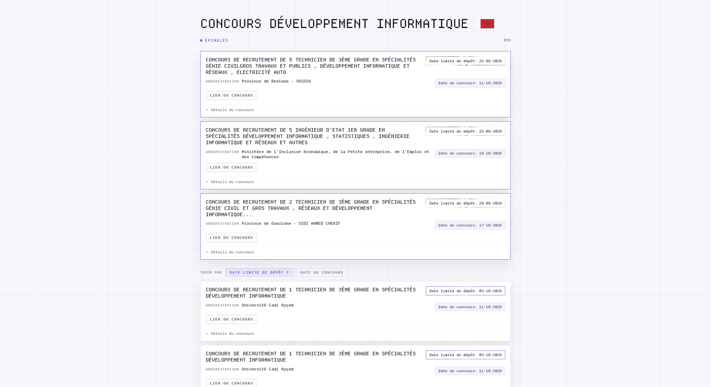

<div align="center">

# Concours Tracker

[](https://workers.cloudflare.com/)
[](https://hono.dev/)
[](https://developers.cloudflare.com/d1/)
[](https://www.typescriptlang.org)
[](LICENSE)

:star: If you find this project helpful, please consider starring it on GitHub!

[Overview](#overview) • [Features](#features) • [How it works](#how-it-works) • [Getting Started](#getting-started) • [Email Flows](#email-flows) • [Deployment](#deployment)



</div>

## Overview

**Concours Tracker** checks Moroccan public-sector job listings on `wadifa-info.com`, keeps the software and web development roles, and shares them on a website, by email, and through RSS.

The app runs on Cloudflare Workers and stores its listings in Cloudflare D1.

## Features

- **Hosting and storage.** The app runs on Cloudflare Workers, and D1 stores the listings.
- **Two-step filtering.** Simple rules in French and Arabic handle the clear cases. Anything unclear goes to an AI model, which must cite the listing or its official PDF before marking a job as relevant.
- **Scheduled refresh.** Listings update every five hours, and expired competitions are removed.
- **Double opt-in signups.** An address joins the mailing list only after its owner clicks a confirmation link.
- **Email digests.** Subscribers get one summary per notification slot, at the hours you configure.
- **Website and RSS feed** for browsing or subscribing.
- **Bot protection.** Cloudflare Turnstile guards the signup form.

## How it works

Concours Tracker runs as a single Cloudflare Worker. It answers web requests (the site, the RSS feed, and the API) and also runs on a timer to look for new listings.

New listings are filtered by rules first. Anything the rules can't decide goes to an AI model, which must cite the listing or its attached document. The results are saved to the database, and the fresh listings are emailed to subscribers.

Main tools:

- **Hono** for routes and server-rendered HTML.
- **Cloudflare D1** for storing listings.
- **Cron Triggers** for scheduled scraping and notification checks.
- **Cheerio** for reading listing pages.
- **Zod** for validating incoming data.
- **Brevo** for sending email and managing the mailing list.
- **OpenRouter** for reviewing ambiguous listings.

## Getting Started

### Prerequisites

- [Bun](https://bun.sh/) for development, package management, and tests
- [Wrangler CLI](https://developers.cloudflare.com/workers/wrangler/install-and-update/)
- Optional, for capturing email locally: Docker and Mailpit
- For production email and classification: [Brevo](https://app.brevo.com/), [OpenRouter](https://openrouter.ai/), and [Cloudflare Turnstile](https://www.cloudflare.com/products/turnstile/) accounts

### Installation

```bash
git clone https://github.com/mouadlotfi/concours-tracker.git
cd concours-tracker
bun install
```

### Configure the local environment

```bash
cp .env.dev.example .env.dev
```

`.env.dev` is gitignored. `bun run dev` loads it through `wrangler dev --env-file .env.dev`. See [`.env.example`](.env.example) for variable descriptions.

To test email without contacting subscribers, run [Mailpit](https://mailpit.axllent.org/). It captures outgoing messages in a local inbox at <http://127.0.0.1:8025>:

```bash
docker run --rm -p 1025:1025 -p 8025:8025 axllent/mailpit   # Docker
brew install mailpit && mailpit                             # Homebrew
sudo sh < <(curl -sL https://raw.githubusercontent.com/axllent/mailpit/develop/install.sh) && mailpit   # script (Linux & macOS)
```

The example `.env.dev` sets `MAILPIT_URL`, so the local worker sends mail to Mailpit instead of Brevo.

### Set up the local database

```bash
bunx wrangler d1 execute concours-db --local --file=schema.sql
```

### Load some sample data

The schema starts with empty tables. Load the saved development listings to populate the local site:

```bash
bun run db:seed
```

### Start the local app

```bash
bun run dev          # http://127.0.0.1:8787
```

### Local testing

The example `.env.dev` sets `CRON_SECRET`. `/api/refresh` returns 401 unless the request includes the matching `secret`.

Run the scrape and classification pipeline without saving results or sending email:

```bash
curl "http://127.0.0.1:8787/api/refresh?secret=dev-cron-secret&dry_run=true&reclassify=true"
```

To inspect a test notification in Mailpit, first confirm `.env.dev` has `MAILPIT_URL` set. Then send a test message to `TEST_EMAIL`. This test route ignores the notification schedule and does not mark listings as notified:

```bash
curl "http://127.0.0.1:8787/api/refresh?secret=dev-cron-secret&force_email=true"
```

Use `notify=false` to save refreshed listings without sending a notification.

The notification regression tests use an in-memory database and mocked email requests. They never send real email:

```bash
bun test src/index.notify.test.ts
```

### Commands

| Command | Purpose |
|---|---|
| `bun run dev` | Start the local worker and load `.env.dev` |
| `bun test` | Test suite |
| `bun run lint` | Typecheck (`tsc --noEmit`) |
| `bun run db:seed` | Load `seeds/dev.sql` into local D1 |
| `bun run db:reset` | Delete all local listings |
| `bun run deploy` | Deploy to Cloudflare |

## Email flows

The app sends three kinds of email:

1. **Confirmation.** `POST /api/subscribe` sends a confirmation link that expires after 48 hours.
2. **Welcome.** Once the recipient confirms, the app adds the address to the Brevo list and sends a welcome message.
3. **New listings.** Subscribers receive one digest during each notification slot, ordered by application deadline.

An address is added to the mailing list only through `POST /api/confirm`, not `POST /api/subscribe`. Both new and already-subscribed addresses get the same response from the subscribe endpoint, so it does not reveal whether an address is already subscribed.

Unsubscribing uses a self-contained link (`/unsubscribe` → `POST /api/unsubscribe`), so nothing needs to be stored.

### Notification schedule

The scraper runs every five hours. The notification check runs hourly and sends only during `NOTIFY_HOURS`, interpreted in `NOTIFY_TIMEZONE`. The defaults in `wrangler.toml` are 08:00 and 18:00 in `Africa/Casablanca`.

- Listings found between notification slots wait until the next slot.
- Before sending, the worker claims each relevant listing in D1. Later runs skip claimed listings, including overlapping runs.
- If the claim cannot be saved, the worker does not send the email.
- If the email provider returns an error or the result is uncertain, the worker does not retry automatically. Check the logs and provider delivery history before retrying, since a retry could duplicate messages.
- A manual `GET /api/refresh` sends pending notifications immediately, without waiting for a scheduled slot.

## Deployment

1. **Log in to Cloudflare.**

   ```bash
   bunx wrangler login
   ```

2. **Create the production database** on the first deploy. Copy its `database_id` into `wrangler.toml`:

   ```bash
   bunx wrangler d1 create concours-db
   ```

3. **Initialize the schema** on the first deploy.

   > `schema.sql` drops and recreates its tables. Run it only against a new, empty database.

   ```bash
   bunx wrangler d1 execute concours-db --remote --file=schema.sql
   ```

   For a database that already contains data, add the notification column and backfill it. The backfill prevents the next notification pass from emailing every existing listing.

   ```bash
   bunx wrangler d1 execute concours-db --remote --command \
     "ALTER TABLE concours ADD COLUMN notifiedAt DATETIME; UPDATE concours SET notifiedAt = CURRENT_TIMESTAMP WHERE notifiedAt IS NULL;"
   ```

   If the database tracks migrations, use `bunx wrangler d1 migrations apply concours-db --remote` instead. You can check by running `SELECT name FROM d1_migrations` against the database.

   Before deploying, check `notifiedAt` for listings that were already emailed. If any have a `NULL` value, update only the IDs confirmed as delivered. Otherwise, the next notification check may send those listings again. For a partially delivered batch, check each recipient's delivery history before changing notification state.

4. **Set production secrets.** See [`.env.example`](.env.example) for the full list:

   ```bash
   bunx wrangler secret put SMTP_API_KEY
   bunx wrangler secret put SMTP_SENDER_EMAIL
   bunx wrangler secret put SMTP_LIST_ID
   bunx wrangler secret put UNSUBSCRIBE_SECRET
   bunx wrangler secret put SUBSCRIBE_CONFIRM_SECRET   # optional; falls back to UNSUBSCRIBE_SECRET
   bunx wrangler secret put CRON_SECRET
   bunx wrangler secret put OPENROUTER_API_KEY
   bunx wrangler secret put NEXT_PUBLIC_TURNSTILE_SITE_KEY
   bunx wrangler secret put TURNSTILE_SECRET_KEY
   ```

5. **Deploy the worker.**

   ```bash
   bun run deploy
   ```

## License

This project is licensed under the GNU General Public License v3.0. See the [LICENSE](LICENSE) file for details.
